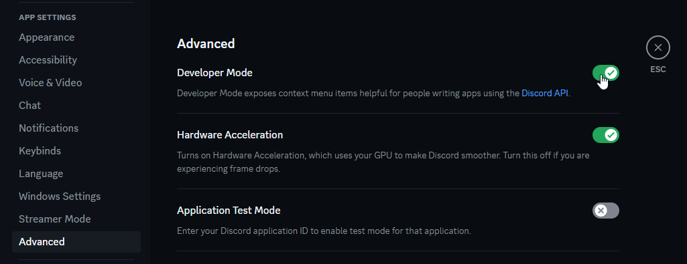

# Discord Bot Guide

The Discord bot is optional. It lets you:

* Run DotProxy commands from a Discord channel (prefix `.`, for example `.status`)
* Get notifications and alerts, such as disconnects or players entering visual range
* Relay chat between the Minecraft server and a Discord channel, in both directions

## Create the Bot

1. Go to the [Discord Developer Portal](https://discord.com/developers/applications).
2. Click **New Application**, give it any name (for example `My DotProxy`), accept the terms, and click **Create**.

## Get the Bot Token

1. In the left sidebar, open the **Bot** page.
2. Click **Reset Token** and confirm.
3. The token appears with a **Copy** button. Copy it and keep it somewhere safe. Discord only shows it once.

!!! warning

    Anyone with your bot token can control your bot. Never share it.

## Bot Settings

On the **Installation** page:

* Set **Install Link** to **None**
* Make sure **Guild Install** is checked
* **User Install** doesn't matter

On the **Bot** page:

* Turn **off** **Public Bot**, so only you can add the bot to servers
* Turn **on** **Message Content Intent**, under "Privileged Gateway Intents"

## Invite the Bot to Your Server

1. Open the **OAuth2** page and scroll to the **OAuth2 URL Generator**.
2. Under **Scopes**, check `bot`.
3. Under **Bot Permissions**, check `Send Messages`.
    * Optional: if you want the bot to manage its own nickname, also check `Change Nickname`.
4. Set **Integration Type** to **Guild Install**.
5. Copy the **Generated URL** at the bottom, open it in a browser, and pick the server to add the bot to.

## Discord Server Setup

Open your Discord server's menu (click the server name) and go to **Server Settings**.

1. Under **Roles**, click **Create Role** and make a role for the people allowed to manage DotProxy (for example `DotProxy Manager`).
2. Give that role to yourself and anyone else who should manage the bot.
3. Create a text channel for managing the bot (for example `#dotproxy`). Click the **+** next to a category in the channel list.
4. (Optional) Create a second text channel for the chat relay (live in-game chat).

## Configure DotProxy

To copy role and channel IDs, first turn on **Developer Mode** in your Discord user settings, under **App Settings > Advanced**:



Then right-click a role or channel and choose **Copy Role ID** / **Copy Channel ID**.

Enter the values in the DotProxy terminal using the [`discord`](Commands.md#discord_1) command:

```
discord token <bot token>
discord channel <management channel ID>
discord role <manager role ID>
discord on
```

The bot (re)starts automatically after these changes. Check that it's working by typing `.status` in the management channel.

### Chat Relay (optional)

```
discord relayChannel <chat relay channel ID>
chatRelay on
```

Messages typed in the relay channel are sent as chat in-game, and replies to relayed messages are sent as whispers. See [`chatRelay`](Commands.md#chatrelay) for more options, such as mentions and ignore filters.

### Notifications

Use [`discordNotifications`](Commands.md#discordnotifications) to choose which events ping your role.
