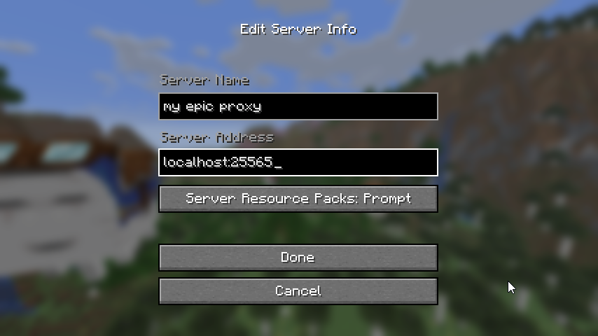
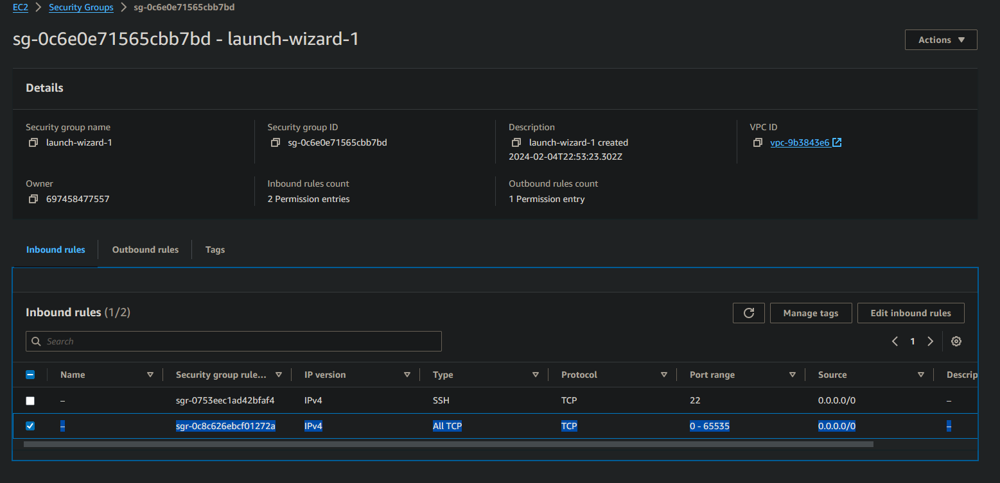

# Frequently Asked Questions (FAQ)

## Switch Accounts

`disconnect`

`auth clear`

`connect`

If the Microsoft website signs you in to the wrong account automatically, open the login link in a private/incognito window.

## Switch the server DotProxy connects to

`server <address>` or `server <address> <port>`

Example: `server play.example.com`

Then reconnect: `disconnect` followed by `connect`, or just `reconnect`.

## I keep getting disconnected!

See [Disconnects](./Disconnects.md).

Disconnects like these:

> Read timed out.

> Connection closed

> java.net.SocketException: Connection Reset

> io.netty.channel.unix.Errors$NativeIoException: Broken Pipe

are caused by problems with the internet connection between DotProxy and the server. DotProxy can't prevent them.

Turn on [`autoReconnect`](./Commands.md#autoreconnect) so DotProxy reconnects on its own. If your internet connection is unstable, consider hosting on a VPS.

## How do I keep my AFK farm running?

1. Stand where the farm needs you, then disconnect from the proxy. The account stays online.
2. Turn on the modules that keep the account in-game:
    * [`antiAFK`](./Commands.md#antiafk) avoids idle kicks.
    * [`autoReconnect`](./Commands.md#autoreconnect) reconnects after server restarts and connection drops.
    * [`autoRespawn`](./Commands.md#autorespawn) respawns if the account dies.
3. Optionally, turn on [`autoDisconnect`](./Commands.md#autodisconnect) to log out on low health or when another player comes near.

Check the server's rules first. Some servers don't allow AFKing or AntiAFK.

## I don't know how to connect to my proxy!

Run the DotProxy command `status`.

Look for `Proxy IP`.

Add a server with that address in your Minecraft client:



Make sure your username is whitelisted: `whitelist add <username>`

## I can't connect to my proxy!

First, run the DotProxy command `connectionTest`.

If it shows a firewall error, open the proxy's port (default `25565`, TCP) in your host's firewall:

### Oracle Cloud

```bash
sudo iptables -I INPUT -j ACCEPT
sudo su
iptables-save > /etc/iptables/rules.v4
exit
```

source: https://www.reddit.com/r/oraclecloud/comments/r8lkf7/a_quick_tips_to_people_who_are_having_issue/

### AWS

AWS calls its firewall a "Security Group".

Edit the Security Group attached to your instance and add an inbound rule that allows TCP traffic on the proxy's port:



### Google Cloud

Open **VPC network > Firewall** (or **Network Security > Firewall policies**) and create a firewall rule for the network attached to your VM:

* Direction of traffic: **Ingress**
* Action on match: **Allow**
* Targets: **All instances in the network**
* Source IPv4 ranges: `0.0.0.0/0`
* Protocols and ports: TCP, with the proxy's port (or **Allow all**)

### Other

Check your provider's website and documentation.

## I'm hosting DotProxy on my home PC. How can my friends connect?

### Option 1: Tunneling

Use a service like [playit.gg](https://playit.gg/) to create a network tunnel your friends can connect through.

Set it up the same way as a normal Minecraft server, using the port DotProxy listens on. Use the `serverConnection` command to check the port.

### Option 2: Port Forwarding

Automatic port forwarding: `serverConnection upnp on`

Depending on your router, the automatic method may not work.

If it doesn't, set up port forwarding on your router manually. Search for your router model plus "port forwarding" to find instructions.

### Option 3: VPS

Host DotProxy on a VPS instead of your home PC.

A VPS has a public IP address anyone can connect to. See [Hosting Providers](./Hosting-Providers.md).

## Can I run DotProxy while my PC is off?

No. DotProxy has to run on a computer that's turned on.

Some people use a spare computer. Others rent a computer in a datacenter (a VPS). See [Hosting Providers](./Hosting-Providers.md).

## Can friends watch without controlling the account?

Yes. Add them to the spectator whitelist:

`spectator whitelist add <username>`

Spectators can join while someone else controls the account, and can watch from that player's view. See [`spectator`](./Commands.md#spectator).

## How can I make my minimap/world map mod work while using DotProxy?

Map mods like Xaero's usually pick which map and waypoint files to use based on the server address.

DotProxy has a different address than the server you'd normally connect to directly, so the mod opens a separate, empty map.

### Option 1: Change the map folder mode

Some map mods can choose the map folder by the server's **name** in your server list instead of its address. If yours can, give the direct server and the proxy the same name in your server list, and they'll share map files.

You may need to copy or move your existing map/waypoint files to the new folder by hand.

### Option 2: Symlinks

A symlink works like a shortcut to a folder: it forwards one folder to another.

You can symlink the map/waypoint folder used for the proxy's address to your main map/waypoint folder.

## Who are these unknown people pinging or trying to connect to my proxy?

If you host something on your home PC, in most cases it is _not_ exposed to the public internet by default.

Windows has a firewall, and your router needs port forwarding set up before outside connections can reach you.

If you host something on the public internet, anyone on the internet can find it.

There are only about 4 billion possible IPv4 addresses, and all of them can be scanned in under an hour.

People have been scanning the internet for Minecraft servers like this for many years.

Finding your proxy's public IP does not let them past the whitelist.

If you're hosting on the public internet and this makes you uncomfortable, you can:

* Turn off server list pings: `serverConnection ping off`
* Set up a DNS hostname, set it with `serverConnection proxyIP <domain>`, then run `serverConnection enforceMatchingConnectingAddress on`
    * If you don't own a domain, there are free options like [DuckDNS](https://www.duckdns.org/), [No-IP](https://www.noip.com/), and [Dynu](https://www.dynu.com/)
* Make the proxy harder to find: `serverConnection port <port>` with a non-standard port, maybe a random one between 30000 and 65535
* Set up a firewall that only allows your and your friends' IPs to connect
* Host the proxy on a private network using tools like Tailscale
