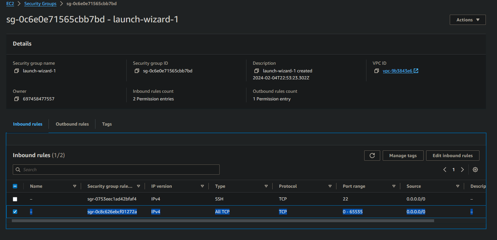

# Hosting Providers

DotProxy runs on any computer, including your own. To keep an account online 24/7 without leaving your PC on, many people rent a computer in a datacenter (a VPS or dedicated server).

DotProxy needs very little: about 300MB of RAM, Java 21+, and an open TCP port for the proxy (default `25565`). The smallest VPS plans from most providers are enough.

Below are some companies that offer hosting. None of them are affiliated with DotProxy.

!!! tip

    Lower ping to the Minecraft server you play on means a smoother connection. Pick a datacenter region close to that server.

## Providers with Free Tiers/Trials

### Oracle Cloud

https://www.oracle.com/cloud/free/

The "Always Free" tier includes both x64 and ARM "Compute Instances".

??? "Firewall Help"
    Set up the instance, then run these commands over SSH:
    ``` bash title="shell"
    sudo iptables -I INPUT -j ACCEPT
    sudo su
    iptables-save > /etc/iptables/rules.v4
    exit
    ```
    source: https://www.reddit.com/r/oraclecloud/comments/r8lkf7/a_quick_tips_to_people_who_are_having_issue/

    You also need to allow the port in the instance's VCN Security List (Ingress Rules).

### AWS

https://aws.amazon.com/free/

Free plan with starting credits for new accounts.

??? "Firewall Help"
    Set the "Security Group" of your EC2 instance to allow inbound TCP traffic on the proxy's port:
    

### Google Cloud

https://cloud.google.com/free

Free trial credit for new accounts, plus an ongoing Free Tier that includes one `e2-micro` instance.

??? "Firewall Help"
    Open the firewall settings for the network attached to your VM (**VPC network > Firewall**) and create a firewall rule with:

    * Direction of traffic: **Ingress**
    * Action on match: **Allow**
    * Targets: **All instances in the network**
    * Source IPv4 ranges: `0.0.0.0/0`
    * Protocols and ports: TCP with the proxy's port (or **Allow all**)

### DigitalOcean

https://www.digitalocean.com/

Simple VPS ("Droplets"), often with free trial credit for new accounts.

### Azure

https://azure.microsoft.com/en-us/pricing/purchase-options/azure-account

Free trial credit for new accounts, plus a 12-month free tier with Linux VMs.

### Alibaba

https://www.alibabacloud.com/en/free

Free trial with credit for new accounts.

## Paid-only Providers

### OVH

https://us.ovhcloud.com/vps/

VPS stock is often limited, but prices are very competitive for the specs.

### Hetzner

https://www.hetzner.com/cloud/

Very affordable. Datacenters are mainly in the EU, with some in the US and Singapore.

### Vultr

https://www.vultr.com/

## After Creating a Server

1. Connect over SSH and install Java 21+. See the [Linux Guide](Linux-Guide.md).
2. Follow the [Setup guide](Setup.md).
3. Open the proxy's port in the provider's firewall. See the "Firewall Help" sections above.
